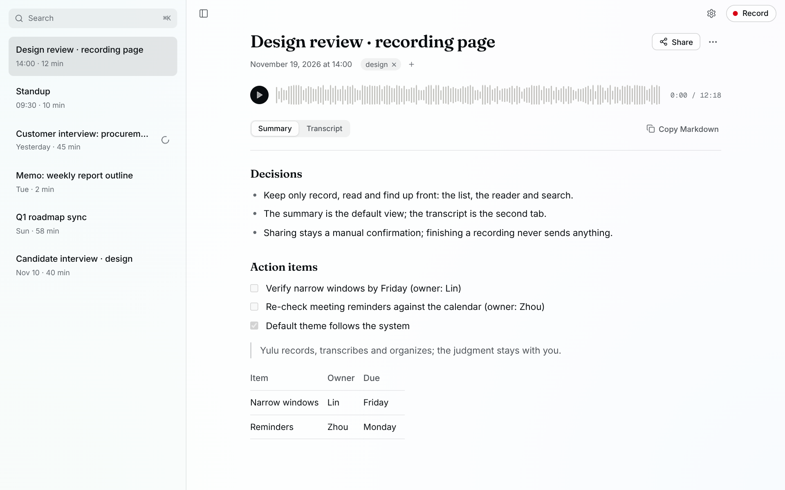
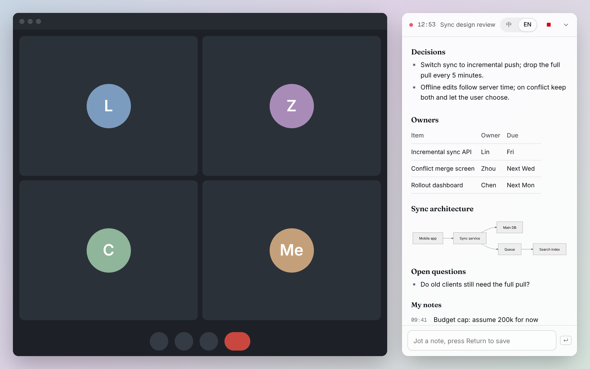
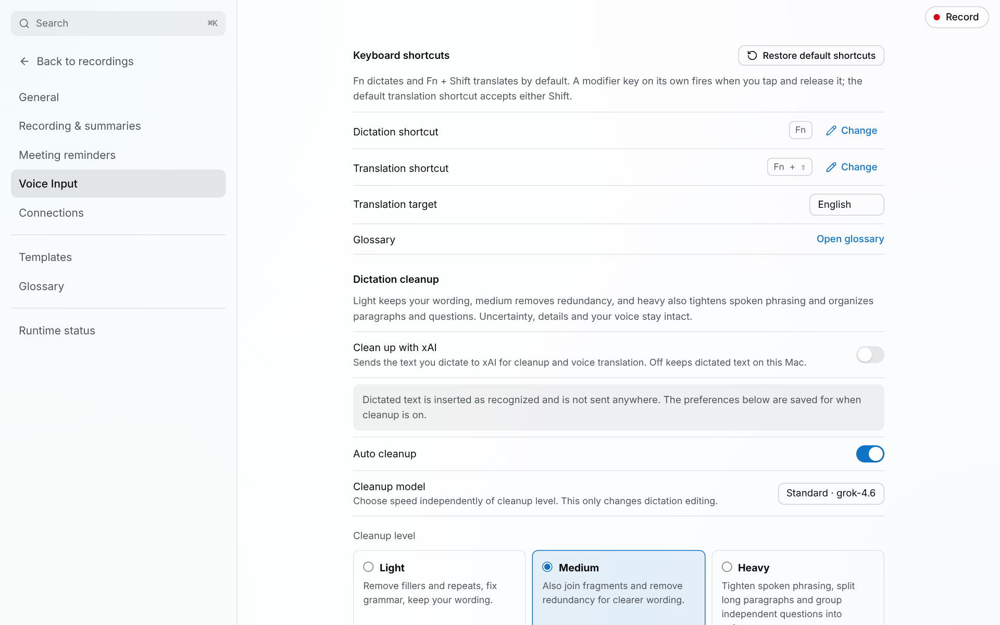
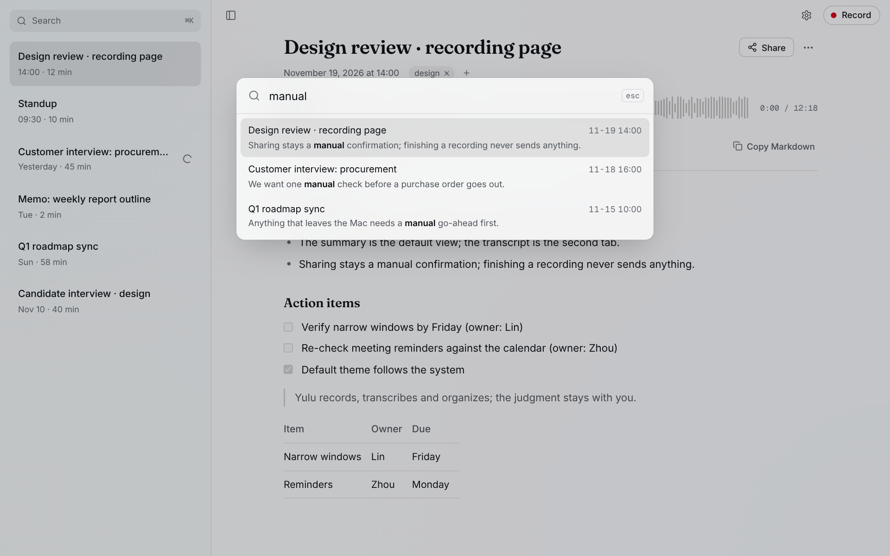
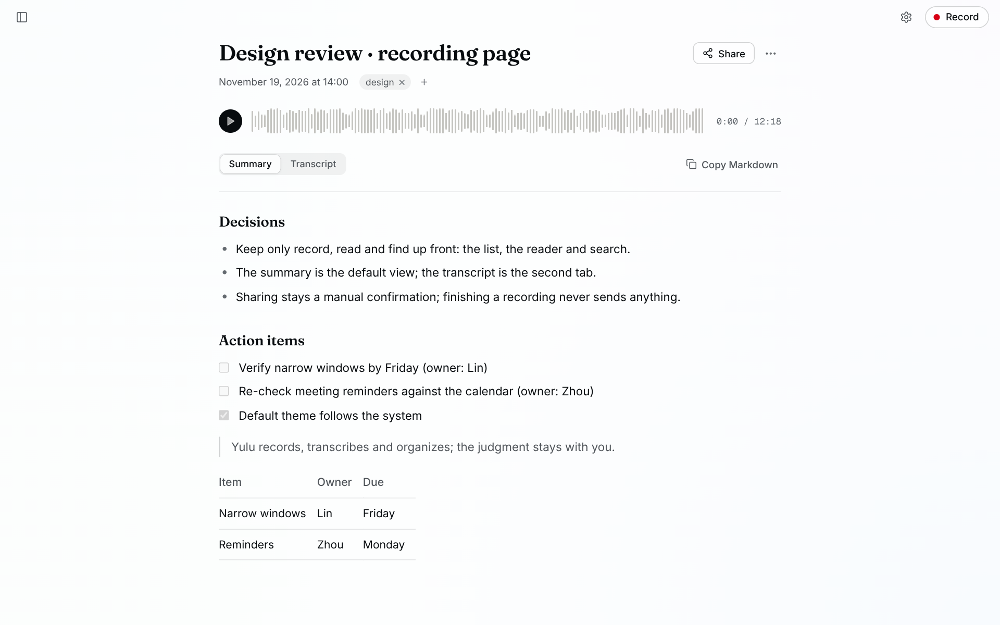
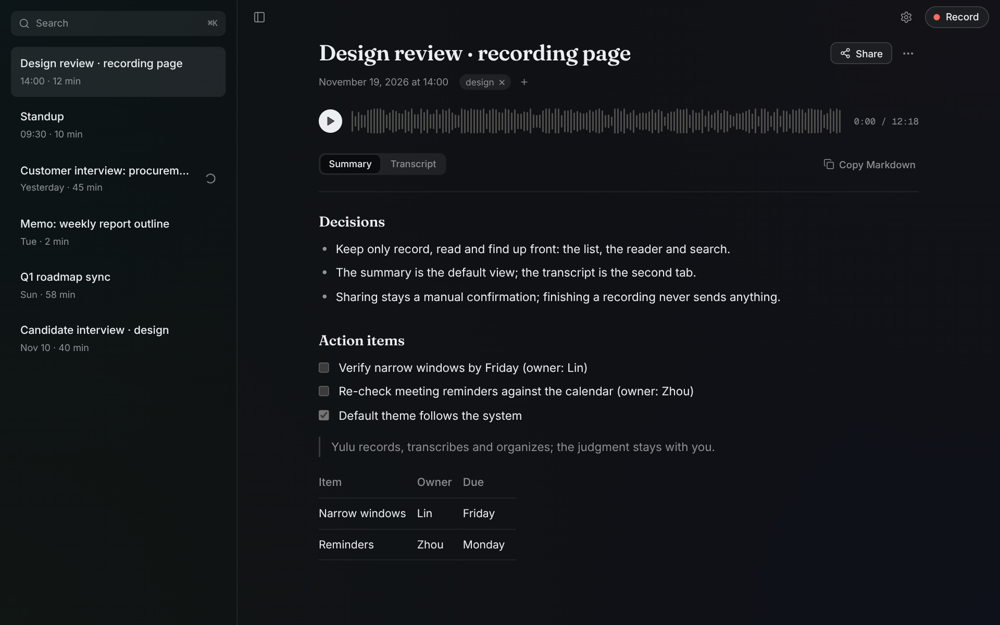
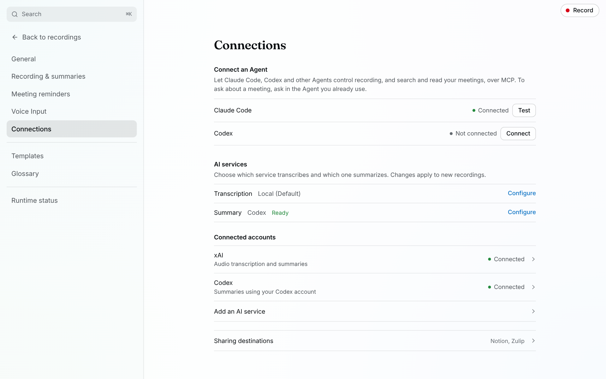

  <picture>
    <source media="(prefers-color-scheme: dark)" srcset="assets/logo-dark.svg" />
    
  </picture>
  <h1>Yulu</h1>
  
<b>Native meeting capture. Live notes. Agent-ready memory.</b>

  
<b>English</b> · <a href="README.zh-CN.md">简体中文</a>

  
<a href="https://github.com/Nowhitestar/Yulu/releases/latest">Download for macOS</a> · <a href="CHANGELOG.md">Changelog</a> · <a href="LICENSE">MIT License</a>

Yulu is a macOS workspace for meeting notes and voice input. Record system audio
and your microphone, find decisions in past meetings, or dictate into the app
you are using. No Yulu account or virtual audio device required.

## Design choices

- **Useful files you can keep.** Audio, plain-text transcripts, and Markdown
  summaries live on your Mac, ready to back up, move, and use in other tools.
- **Build on your existing AI workflow.** Choose transcription and summary
  providers independently, including xAI, Codex, or Claude Code for summaries.
  Through [MCP](docs/operations.md#dmg-and-cli-entry-points), your own Agent can
  control recording, search meeting history, and answer questions about it.
- **Capture directly on your Mac.** System audio and microphone capture need
  no meeting bot or virtual audio device. Live notes, calendar reminders, and
  meeting detection support the workflow.
- **Voice input beyond meetings.** Dictate into your current app or translate
  with a global shortcut. Optional xAI cleanup has three editing levels and
  separate punctuation styles; the original text stays available.

[What's new in v0.32.2](docs/release-notes/v0.32.2.md):
live notes work again — every update had been failing before reaching xAI.
The menu bar menu lists your next meetings with join and record, the menu bar
shows the next meeting shortly before it starts, and **Open at login** keeps
Yulu waiting there after you log in.

## Features

### Recording meetings

- **System audio and your microphone** in one native recording, with no meeting
  bot or virtual audio device. A recording stops by itself after five minutes
  of silence; the limit is adjustable.
- **Meeting reminders.** Connect macOS Calendar, or Google Calendar through
  `gog`, and Yulu offers to record when a meeting starts. For a meeting with a
  video link, **Record and join** opens the call and starts recording together.
- **Meeting detection.** Yulu can also notice a meeting window that is not on
  your calendar, such as Zoom, and ask whether to record. Nothing records until
  you choose.
- **Live notes.** While you record, a panel on the right edge of the screen
  keeps the meeting's key points as rich text: lists, tables, even small
  architecture diagrams, in Chinese or English. Type your own notes into the
  same panel without leaving the meeting app. Collapse it to the Yulu logo
  whenever you like. Live notes use a fast xAI model and are on by default.
  They start once xAI is connected and you accept a short data notice in
  **Settings → Recording & summaries**, where you can also turn them off; your
  own notes are kept either way.
- **Notes, summary and transcript together.** Each recording keeps its live
  notes next to its summary and transcript. When the live transcript already
  covers the whole recording, Yulu keeps it instead of transcribing again.

### Transcripts and summaries

- **Two audio engines, chosen explicitly.** The default local engine runs on
  your Mac with no usage fee (a one-time download of about 1 GB, about 320 MB
  kept). xAI cloud transcription is an opt-in with its own consent. Chinese,
  English, and automatic detection are supported; Japanese needs xAI.
- **Glossary.** Add names and jargon once. Transcription prefers them when it
  hears something close, and dictation cleanup uses the entries it matches.
- **Summaries with templates.** xAI, Codex, or Claude Code writes the summary
  from a template. Edit the built-in ones or add your own, mark one to run on
  every new recording, and re-generate any summary with another template.
- **No silent switching.** Each recording keeps the provider and model it was
  created with. If that provider is unavailable, Yulu waits for you instead of
  using another one.
- **A library you can work with.** Waveform playback, tags, full-text search
  across summaries and transcripts, and **Copy Markdown**.
- **Sharing and Agents.** Share a summary to Notion or Zulip through your
  Agent's connector, confirming each share. Claude Code, Codex, and other MCP
  clients can start recordings, search meetings, and read summaries.

### Dictation and translation

Voice input works in any app, not just Yulu.

- **Dictate with Fn.** Press **Fn**, speak, and press it again. Yulu types the
  text at your cursor and checks that it arrived; if it cannot confirm, the
  text stays on the clipboard. Every result is kept in the Voice Input history.
- **Translate as you speak with Fn+Shift.** Speak in one language and Yulu
  inserts the translation in another: English by default, or any language you
  set. If translation fails, the recognized text is kept and nothing
  untranslated is pasted.
- **Cleanup that keeps your meaning.** Three levels turn speech into writing
  and three styles (formal, casual, very casual) set the punctuation. Names,
  numbers, negations, and uncertainty are kept, and the original text is always
  available to copy.

  | You said | *"Um, tomorrow at three. No, four. Let's meet. Don't send the draft yet."* |
  |---|---|
  | Light | Tomorrow at four, let's meet. Don't send the draft yet |
  | Medium | Let's meet tomorrow at four. Don't send the draft yet |
  | Heavy | Same as medium for a short note; longer dictation is split into paragraphs, and separate questions become a numbered list |

- **Your kind of shortcut.** Press once to start and again to finish, or hold
  to talk and release to finish. Any key works, including Fn alone or a
  specific left or right modifier. Short sounds mark start, success, and
  failure, and a small panel shows your voice level with finish and cancel.
- **You decide where text goes.** With the local engine, dictation stays on
  your Mac and is inserted as recognized. Cleanup and translation run on xAI:
  they need xAI as the audio engine and **Clean up with xAI** turned on, and
  they send only the dictated text and the glossary entries it matches.

### Around the app

- **Updates.** Yulu checks for a new version about once a day. When it finds
  one, it asks before installing and never installs during a recording; if
  Yulu is in the background, a notification tells you. Check any time from the
  menu-bar menu (**Check for Updates…**) or **Settings → General**, where
  automatic checks can also be turned off.
- **Menu bar and window.** Yulu lives in the menu bar as well as its window;
  hide the Dock or menu bar icon and recording, reminders, and shortcuts keep
  working. Turn on **Open at login** to have it waiting in the menu bar after
  you log in. The menu lists your next meetings with join and record, and the
  menu bar shows the next meeting's title shortly before it starts.
- **Chinese and English**, with light, dark, and custom themes.

## The window

v0.28.0 redesigned the app around two principles.

**Simple, not simplistic: nothing taken away, only the daily things up front.**
You do three things with Yulu every day: record, read, and find. So the window
shows a Record button, the recordings list, and search. Everything else is one
step away, not gone:

- Re-transcribing, re-generating a summary with another template, renaming, and
  deleting live in the reading sheet's **⋯** menu.
- Templates, the glossary, and runtime diagnostics live in Settings.
- Asking about a meeting happens in the Agent you already use, through MCP.
- Each surface has one main action: the list opens, the reading sheet shares,
  and a settings row pairs one label with one control.
- Status shows up only when it needs you. A finished recording carries no
  badge, a spinner means it is still processing, and a warning mark means it
  failed (hover for the reason).

**Beautiful: proportion, whitespace, and type instead of decoration.** The
references were the Claude desktop app, Apple's own apps, and Bear.

- Two full-height panes with one hairline between them.
- The text is the subject: a 720px reading column, serif headings (Fraunces,
  with Songti for Chinese), and nothing loud in the toolbar.
- One rhythm everywhere: the same row height, hairline, and small radius, so
  settings, runtime status, templates, and the glossary read as one product.
- Color carries meaning only. Blue is clickable; green, amber, and red are
  status; everything else is gray.
- Glass only where something floats. The list pane is softly translucent, and
  menus, the share panel, and ⌘K frost what is under them. Shadows are
  reserved for those floating layers.

**Small details**

- **One search for everything.** ⌘K, or the search field above the list,
  searches recordings, summaries, and transcripts and jumps to any settings
  page. Empty, it lists every page.
- **Settings in place.** Opening Settings turns the left pane into the
  settings list; **Back to recordings** returns to the meeting you were reading.
- **A pane that steps aside.** Hide the list with the toolbar button or ⌃⌘S,
  the macOS sidebar shortcut. Yulu remembers the choice.
- **Times that read like speech.** Today's meetings show a time, then
  *Yesterday*, then a weekday, then a date.
- **Summary first.** A recording opens on its summary, with the live notes and
  the transcript in the next tabs and **Copy Markdown** beside them.
- **A toolbar that is also a title bar.** Its empty space drags the window,
  and a double-click zooms it.
- **Every theme kept.** Light, dark, follow-system, Ayu, Paper, and custom
  colors all draw from the same semantic tokens.

| | |
|---|---|
|  |  |
| **⌘K** searches recordings, summaries, and transcripts | **⌃⌘S** hides the list for reading |
|  |  |
| Dark theme | **Settings → Connections**: Agents and AI services |

*Screenshots use fictional demo data; no real meetings, accounts, or credentials.*

## Get started

Requires **macOS 13+ and Apple Silicon** for official releases.

1. Download the `.dmg` from [GitHub Releases](https://github.com/Nowhitestar/Yulu/releases/latest),
   drag **Yulu.app** into **Applications**, and open it.
   Starting with v0.27.2, releases are signed but not Apple-notarized. If macOS
   blocks the first launch, use **System Settings → Privacy & Security → Open Anyway**
   after checking that you downloaded Yulu from the official release page.
2. Follow setup to grant microphone and system-audio access. Allow input control
   for global shortcuts and automatic text insertion.
3. Install the local speech model, or explicitly connect xAI for cloud
   transcription. Choose a summary provider if you want AI meeting notes.
4. Start a recording from the App or menu bar. Use **Fn** for dictation and
   **Fn+Shift** for translation. [Using Yulu](#using-yulu) covers the rest.

Settings let you customize shortcuts and hide the Dock and menu bar icons
independently. The App includes its runtime and supports in-app updates;
the DMG does not install a global `yulu` shell command.

## Using Yulu

**Record.** Click **Record** in the top-right corner or use the menu bar.
Calendar reminders and meeting detection can prompt you, but recording starts
only when you choose; for a calendar meeting with a link, the button offers
**Record and join**. While recording, the button shows the elapsed time, a level
meter, and a stop control. While you record, the live notes panel keeps the key points
and takes your own notes. When you stop, the live transcript becomes the
transcript (or the selected audio engine writes one if it is incomplete), then
the selected summary provider writes the summary; the list
shows a spinner until both are saved.

**Read.** Select a recording. It opens on the summary; the **Notes** tab has
the live notes and your own notes, and the **Transcript** tab has the full
text. Play the audio from the waveform, add tags under the title, and use **Copy Markdown** to take the
summary elsewhere. **⋯** holds the summary template, re-generate, re-transcribe,
rename, and delete; right-click a row in the list to rename or delete it.

**Find.** Press ⌘K and type. Results show the matching sentence from the
summary or transcript; Return opens it. Empty, the palette lists every page.

**Share.** **Share** sends the summary to a destination set up under
**Settings → Connections → Sharing destinations**. Each share asks for a fresh
confirmation; finishing a recording never sends anything.

**Ask your Agent.** In **Settings → Connections → Connect an Agent**, connect
Claude Code, Codex, or another detected Agent with one click, then **Test** it.
Ask that Agent about your meetings; it reaches Yulu through MCP and keeps its
own history.

**Dictate.** In any app, press **Fn** to dictate and **Fn+Shift** to
translate. Shortcuts, the translation language, and xAI cleanup are in
**Settings → Voice Input**; recent dictation, with its original text, is listed
at the bottom of that page.

| Shortcut | Action |
|---|---|
| ⌘K | Search and go anywhere |
| ⌃⌘S | Show or hide the recordings list |
| j / k | Next or previous recording |
| Fn | Dictate into the current app |
| Fn+Shift | Translate into the current app |
| Esc | Close the palette or a menu |

## Privacy

- Recordings, transcripts, summaries, and history are stored locally. Recordings
  default to `~/Movies/Yulu`; local speech recognition stays on-device.
- Cloud features are opt-in: xAI transcription sends audio to xAI; AI summaries
  send transcripts, dictation cleanup and translation send dictated text, and
  live notes send new transcript text and your notes (never audio), to the
  selected provider. Dictation and live notes each have their own switch and
  disclosure. Live notes are switched on by default, but send nothing until you
  accept their disclosure.
  Providers are selected explicitly, with no silent fallback.
- Sharing a summary requires a separate manual confirmation. Yulu stores its xAI
  credentials in macOS Keychain; Agent connector credentials stay with the Agent.

## More

[Configuration](docs/configuration.md) · [Troubleshooting & CLI](docs/operations.md) ·
[Agent skill](skills/yulu/SKILL.md) · [Development](docs/DEVELOPMENT.md) ·
[Architecture](docs/ARCHITECTURE.md) · [Security](SECURITY.md)
