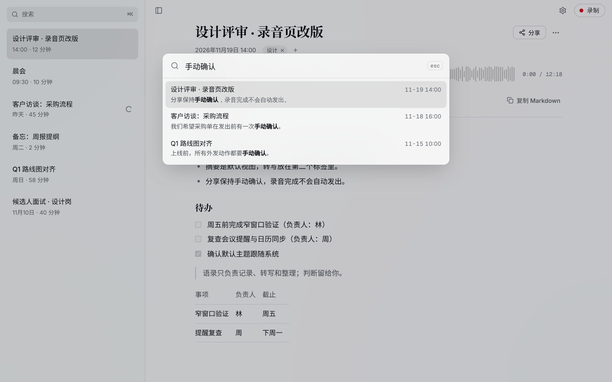
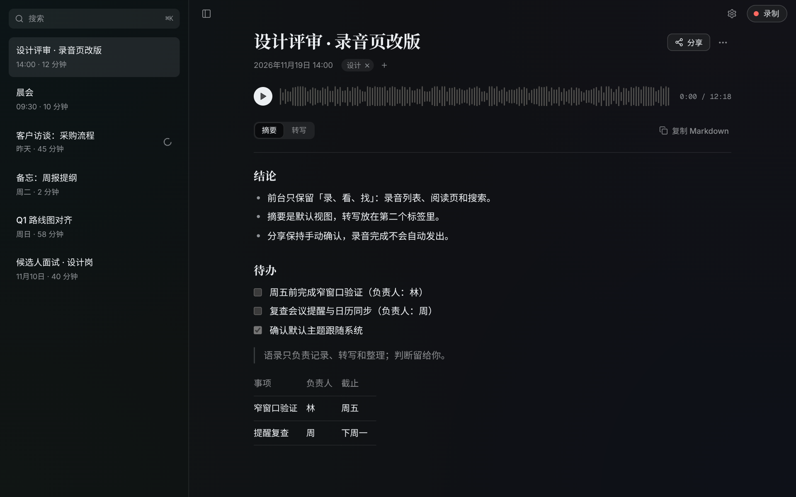
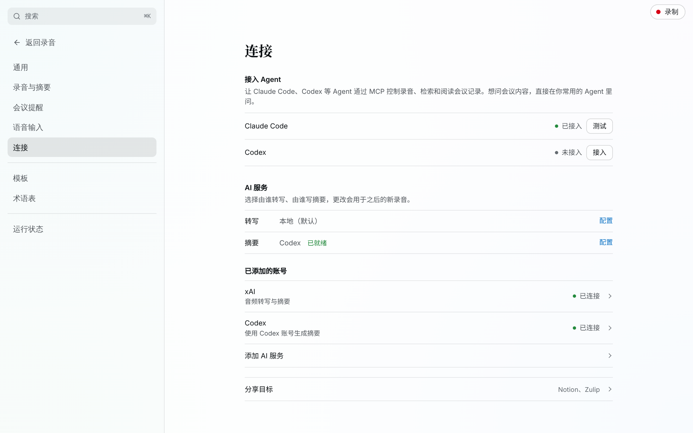

  
  <h1>Yulu · 语录</h1>
  
<b>原生录制，实时字幕，让每场会议成为 Agent 可用的记忆。</b>

  
<a href="README.md">English</a> · <b>简体中文</b>

  
<a href="https://github.com/Nowhitestar/Yulu/releases/latest">下载 macOS 版</a> · <a href="CHANGELOG.md">更新记录</a> · <a href="LICENSE">MIT 许可证</a>

Yulu 是 macOS 上的会议记录与语音输入工具。录制系统声音和麦克风，回查会议决策，
也能直接向当前应用听写输入。无需 Yulu 账号或虚拟声卡。

## 设计思路

- **本地文件，方便复用**：音频、TXT 转写和 Markdown 纪要直接保存在你的 Mac，便于备份、迁移和交给其他工具使用。
- **接入你已有的 AI 工作流**：转写和纪要分别选服务；纪要支持 xAI、Codex 或 Claude Code。通过 [MCP](docs/operations.md#dmg-and-cli-entry-points)，你自己的 Agent 也能控制录音、检索会议记录并回答相关问题。
- **直接在 Mac 上采集**：录制系统声音和麦克风，无需机器人入会或虚拟声卡；配合可移动字幕、双语翻译、日历提醒和会议检测。
- **会议之外也能用**：全局快捷键支持向当前应用听写和快速翻译。可选 xAI 三档文字整理，标点风格独立选择，整理结果与原文都保留。

会议资料库还支持播放、搜索、标签、说话人修正、纪要模板和术语表。

[v0.28.0 更新](docs/release-notes/v0.28.0.md)：窗口精简为一个录音列表加一张阅读页，其余都交给 ⌘K。关于会议的提问改在你自己的 Agent 里通过 MCP 完成。

## 界面

v0.28.0 按两条原则重新设计了整个窗口。

**简约而不简单：能力一项不减，前台只留每天要用的。**
每天用语录只做三件事：录、看、找。所以窗口里只有录制按钮、录音列表和搜索，其余功能都退到一步之外，而不是删掉：

- 重新转写、换模板重新生成摘要、重命名、删除，收在阅读页的「⋯」菜单里。
- 模板、术语表和运行诊断收进设置。
- 想追问会议内容，就在你常用的 Agent 里问，它通过 MCP 读取语录。
- 每个界面只有一个主要动作：列表负责打开，阅读页负责分享，设置里每一行就是「一个标签对一个控件」。
- 状态只在需要你时出现：处理完的录音不带任何标记，处理中显示转圈，失败才出现警示符号，悬停可看原因。

**美：靠比例、留白和字，不靠装饰。** 参照的是 Claude 桌面端、Apple 自带应用和 Bear。

- 两栏铺满窗口，中间只有一条发丝线。
- 正文是主角：720px 阅读宽度，标题用衬线字（英文 Fraunces，中文宋体），工具栏里没有抢眼的东西。
- 全应用一套节奏：同样的行高、发丝线和小圆角，设置、运行状态、模板和术语表看起来是同一个产品。
- 颜色只表达含义：蓝色代表可点，绿、琥珀、红代表状态，其余都是灰阶。
- 玻璃质感只给浮起来的东西：左栏微微透光；菜单、分享面板和 ⌘K 面板会把下层内容磨砂虚化。阴影也只留给这些浮层。

**小巧思**

- **一个搜索管所有**：⌘K 或列表上方的搜索框，能搜录音、摘要和转写，也能直接跳到任意设置页；不输入时列出全部页面。
- **设置就地展开**：进入设置时左栏变成设置目录，「返回录音」会回到你刚才在读的那场会议。
- **侧栏随时让开**：点工具栏按钮或按 ⌃⌘S（macOS 通用的侧栏快捷键）收起列表，语录会记住你的选择。
- **时间像说话一样**：今天的录音只写时间，然后是「昨天」、星期几，再往前才写日期。
- **摘要优先**：打开录音先看摘要，转写在第二个标签，「复制 Markdown」就在旁边。
- **工具栏也是标题栏**：空白处可以拖动窗口，双击可以缩放。
- **主题一个不少**：浅色、深色、跟随系统、Ayu、Paper 和自定义配色，都基于同一套语义色。

| | |
|---|---|
|  |  |
| **⌘K** 同时搜录音、摘要和转写 | **⌃⌘S** 收起列表，专心阅读 |
|  |  |
| 深色主题 | **设置 → 连接**：接入 Agent 与 AI 服务 |

*截图全部使用虚构演示数据，不包含真实会议、账号或凭据。*

## 开始使用

正式版支持 **macOS 13+、Apple Silicon**。

1. 从 [GitHub Releases](https://github.com/Nowhitestar/Yulu/releases/latest) 下载 `.dmg`，将 **Yulu.app** 拖入「应用程序」后打开。
   从 v0.27.2 起，安装包保留开发者签名，但不再经过 Apple 公证。若首次打开被 macOS 拦截，确认来自官方发布页后，到「系统设置 → 隐私与安全性」点「仍要打开」。
2. 按引导授予麦克风与系统音频权限；全局快捷键和自动输入还需要输入控制权限。
3. 安装本地语音模型，或明确连接 xAI 使用云端转写；需要 AI 纪要时，再选择纪要服务。
4. 从 App 或菜单栏开始录音；按 **Fn** 听写、**Fn+Shift** 翻译。更多用法见[使用说明](#使用说明)。

设置中可修改快捷键，也可分别隐藏 Dock 和菜单栏图标。App 自带运行环境，支持应用内更新；DMG 不会安装全局 `yulu` 终端命令。

## 使用说明

**录音**：点右上角「录制」，或从菜单栏开始。日历提醒和会议检测会提示你，但只有你选择后才会开始录音；日历会议带链接时，按钮会变成「录制并加入」。录音中按钮显示时长、音量和停止键。停止后，所选的音频引擎先写转写，再由所选的摘要服务写摘要；两者都保存好之前，列表里会显示转圈。

**阅读**：选中一条录音，默认打开摘要；「转写」标签里是全文，说话人名字可以修正。点声波可以回放，标题下方可以加标签，「复制 Markdown」可把摘要带到别处。「⋯」里有摘要模板、重新生成、重新转写、重命名和删除；在列表里右键某条录音也能重命名或删除。

**查找**：按 ⌘K 直接输入，结果会显示摘要或转写里命中的那句话，回车打开。不输入时，面板列出所有页面。

**分享**：「分享」会把摘要发到你在「设置 → 连接 → 分享目标」里配置的位置。每次分享都要重新确认；录音完成不会自动发出任何内容。

**问 Agent**：在「设置 → 连接 → 接入 Agent」里，一键接入 Claude Code、Codex 或本机检测到的其他 Agent，再点「测试」确认。之后直接在那个 Agent 里问会议内容，它通过 MCP 读取语录，对话记录留在 Agent 自己那里。

**语音输入**：在任意应用里按 **Fn** 听写、**Fn+Shift** 翻译。快捷键、翻译语言和可选的 xAI 文字整理都在「设置 → 语音输入」，页面底部还能找到最近的听写记录和原文。

| 快捷键 | 作用 |
|---|---|
| ⌘K | 搜索，或跳到任意页面 |
| ⌃⌘S | 显示或收起录音列表 |
| j / k | 下一条 / 上一条录音 |
| Fn | 向当前应用听写 |
| Fn+Shift | 翻译后输入当前应用 |
| Esc | 关闭搜索面板或菜单 |

## 隐私

- 录音、转写、纪要和历史记录保存在本机；录音默认位于 `~/Movies/Yulu`，本地语音识别不上传音频。
- 云端能力按需启用：xAI 转写会发送音频；AI 纪要会发送转录文本，听写的文字整理和翻译会发送听写文字到所选服务。服务由你明确选择，不会静默切换。
- 分享纪要需要单独手动确认。Yulu 的 xAI 凭据保存在 macOS 钥匙串，Agent 的连接器凭据由对应 Agent 保管。

## 更多

[配置](docs/configuration.md) · [排障与 CLI](docs/operations.md) ·
[Agent skill](skills/yulu/SKILL.md) · [开发](docs/DEVELOPMENT.md) ·
[架构](docs/ARCHITECTURE.md) · [安全说明](SECURITY.md)
