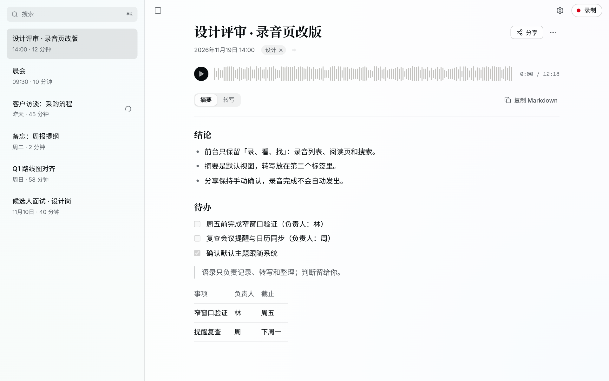
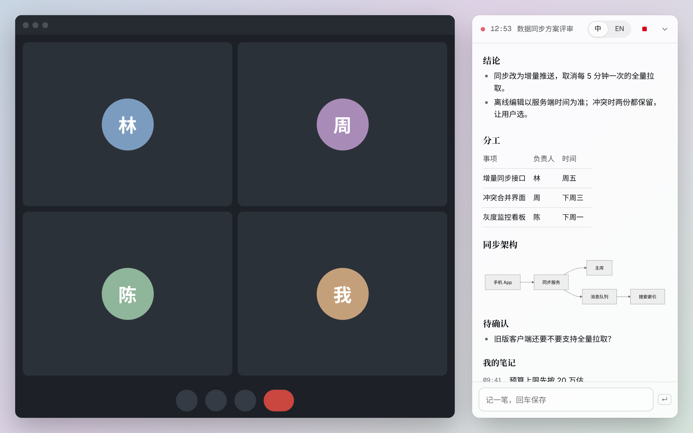
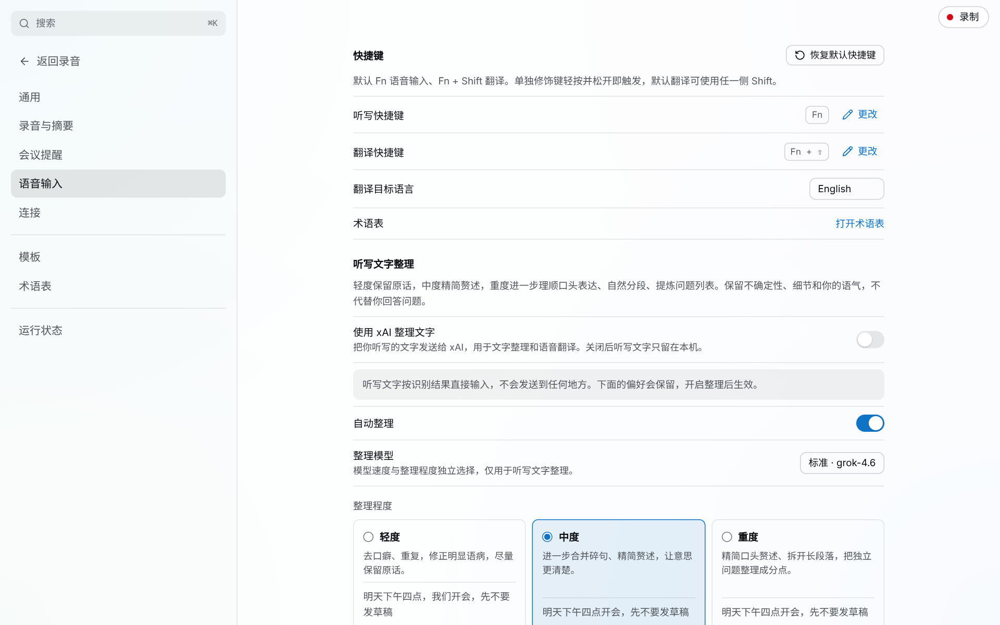
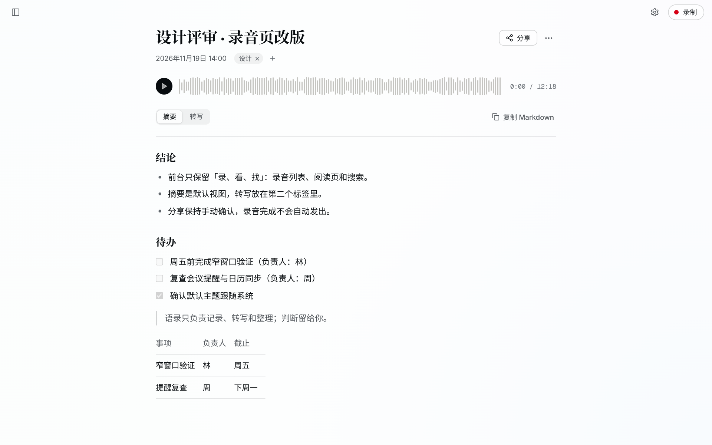

  <picture>
    <source media="(prefers-color-scheme: dark)" srcset="assets/logo-dark.svg" />
    
  </picture>
  <h1>Yulu · 语录</h1>
  
<b>原生录制，实时笔记，让每场会议成为 Agent 可用的记忆。</b>

  
<a href="README.md">English</a> · <b>简体中文</b>

  
<a href="https://github.com/Nowhitestar/Yulu/releases/latest">下载 macOS 版</a> · <a href="CHANGELOG.md">更新记录</a> · <a href="LICENSE">MIT 许可证</a>

Yulu 是 macOS 上的会议记录与语音输入工具。录制系统声音和麦克风，回查会议决策，
也能直接向当前应用听写输入。无需 Yulu 账号或虚拟声卡。

## 设计思路

- **本地文件，方便复用**：音频、TXT 转写和 Markdown 纪要直接保存在你的 Mac，便于备份、迁移和交给其他工具使用。
- **接入你已有的 AI 工作流**：转写和纪要分别选服务；纪要支持 xAI、Codex 或 Claude Code。通过 [MCP](docs/operations.md#dmg-and-cli-entry-points)，你自己的 Agent 也能控制录音、检索会议记录并回答相关问题。
- **直接在 Mac 上采集**：录制系统声音和麦克风，无需机器人入会或虚拟声卡；配合实时笔记、日历提醒和会议检测。
- **会议之外也能用**：全局快捷键支持向当前应用听写和快速翻译。可选 xAI 三档文字整理，标点风格独立选择，整理结果与原文都保留。

[v0.31.0 更新](docs/release-notes/v0.31.0.md)：新的标志——从说出的话落成一行字的一笔，用在 App 图标、菜单栏和实时笔记面板上；菜单栏的空闲、录音中、处理中一眼就能分清。实时笔记默认开启，确认发送内容之前不会发送任何东西。

## 功能

### 录制会议

- **系统声音和麦克风**录在同一份原生录音里，不需要机器人入会，也不需要虚拟声卡。连续静音五分钟会自动停止录音，时长可调。
- **会议提醒**：连接 macOS 日历，或通过 `gog` 连接 Google 日历，会议开始时语录会询问是否录音。会议带视频链接时，「录制并加入」会同时开始录音并打开会议。
- **会议检测**：不在日历上的会议（比如 Zoom 窗口），语录也能发现并询问是否录音。只有你确认后才会开始录。
- **实时笔记**：录音时屏幕右侧出现一张笔记面板，用富文本随时整理会议要点：列表、表格，甚至小的架构图，可选中文或英文。你可以在同一个面板里记下自己的笔记，不用离开会议软件；不需要时收起成语录的 logo。实时笔记使用快速的 xAI 模型，默认开启：连接 xAI 并在「设置 → 录音与摘要」里同意一次数据说明后开始生成，也可以在那里关闭。你自己的笔记无论是否开启都会保存。
- **笔记、纪要、转写放在一起**：每条录音的实时笔记与纪要、转写并列保存。实时转写已经覆盖整段录音时，语录直接采用，不再重新转写。

### 转写与纪要

- **两种音频引擎，由你明确选择**：默认的本地引擎在 Mac 上运行，不收使用费（首次下载约 1 GB，保留约 320 MB）；xAI 云端转写需要你单独同意后才启用。支持中文、英文和自动识别，日语需要 xAI。
- **术语表**：人名和行业词加一次就够。转写遇到相近读音时会优先用这些词，听写整理也会用到匹配的条目。
- **按模板写纪要**：由 xAI、Codex 或 Claude Code 按模板生成纪要。内置模板可以修改，也可以新建；指定一个模板自动用于新录音，任何纪要都能换个模板重新生成。
- **不会悄悄换服务**：每条录音都固定使用创建时选定的服务和模型。服务不可用时，语录会等你处理，不会改用别的服务。
- **好用的资料库**：声波回放、标签、跨纪要和转写的全文搜索，以及「复制 Markdown」。
- **分享与 Agent**：通过 Agent 的连接器把纪要分享到 Notion 或 Zulip，每次都要确认。Claude Code、Codex 等 MCP 客户端可以开始录音、检索会议和读取纪要。

### 听写与听写翻译

语音输入在任何应用里都能用，不只是语录。

- **按 Fn 听写**：按一下 **Fn** 开始说话，再按一下结束。语录会把文字输入到光标处，并确认确实输入成功；无法确认时，文字会留在剪贴板。每次结果都保存在语音输入历史里。
- **按 Fn+Shift 边说边翻译**：用一种语言说，语录直接输入另一种语言的译文。默认译成英文，也可以设成任何语言。翻译失败时会保留识别出的原文，不会把未翻译的文字直接粘贴出去。
- **整理口语，不改原意**：三档整理程度把口语变成书面语，三种表达风格（正式、日常、随意）决定标点多少。人名、数字、否定和不确定的语气都会保留，原文随时可以复制。

  | 你说的话 | *「嗯，明天下午三点。不对，四点。我们开会。先不要发草稿。」* |
  |---|---|
  | 轻度 | 明天下午四点，我们开会，先不要发草稿 |
  | 中度 | 明天下午四点开会，先不要发草稿 |
  | 重度 | 短句与中度相同；长段听写会自然分段，几个独立的问题会整理成编号列表 |

- **快捷键随你习惯**：可以按一下开始、再按一下结束，也可以按住说话、松开结束。任意按键组合都行，包括单独的 Fn 或指定左右侧的修饰键。开始、成功和失败时有短提示音，小浮窗会显示音量，并提供完成和取消按钮。
- **文字去哪由你决定**：使用本地引擎时，听写只留在本机，按识别结果直接输入。文字整理和翻译由 xAI 完成：需要把音频引擎设为 xAI 并打开「使用 xAI 整理文字」，发送的只有听写文字和匹配到的术语。

### 其他

- **检查更新**：语录大约每天自动检查一次新版本。发现新版本时会先征求你的同意再安装，录音时不会安装；语录在后台时会发通知提醒你。也可以随时在菜单栏菜单（「检查更新…」）或「设置 → 通用」里手动检查，自动检查也可以在那里关掉。
- **菜单栏与窗口**：语录既有窗口，也常驻菜单栏；隐藏 Dock 或菜单栏图标后，录音、提醒和快捷键照常工作。
- **中英文界面**，有浅色、深色和自定义主题。

## 界面

v0.28.0 按两条原则重新设计了整个窗口。

**简约而不简单：能力一项不减，前台只留每天要用的。**
每天用语录只做三件事：录、看、找。所以窗口里只有录制按钮、录音列表和搜索，其余功能都退到一步之外，而不是删掉：

- 重新转写、换模板重新生成摘要、重命名、删除，收在阅读页的「⋯」菜单里。
- 模板、术语表和运行诊断收进设置。
- 想追问会议内容，就在你常用的 Agent 里问，它通过 MCP 读取语录。
- 每个界面只有一个主要动作：列表负责打开，阅读页负责分享，设置里每一行就是「一个标签对一个控件」。
- 状态只在需要你时出现：处理完的录音不带任何标记，处理中显示转圈，失败才出现警示符号，悬停可看原因。

**美：靠比例、留白和字，不靠装饰。** 参照的是 Claude 桌面端、Apple 自带应用和 Bear。

- 两栏铺满窗口，中间只有一条发丝线。
- 正文是主角：720px 阅读宽度，标题用衬线字（英文 Fraunces，中文宋体），工具栏里没有抢眼的东西。
- 全应用一套节奏：同样的行高、发丝线和小圆角，设置、运行状态、模板和术语表看起来是同一个产品。
- 颜色只表达含义：蓝色代表可点，绿、琥珀、红代表状态，其余都是灰阶。
- 玻璃质感只给浮起来的东西：左栏微微透光；菜单、分享面板和 ⌘K 面板会把下层内容磨砂虚化。阴影也只留给这些浮层。

**小巧思**

- **一个搜索管所有**：⌘K 或列表上方的搜索框，能搜录音、摘要和转写，也能直接跳到任意设置页；不输入时列出全部页面。
- **设置就地展开**：进入设置时左栏变成设置目录，「返回录音」会回到你刚才在读的那场会议。
- **侧栏随时让开**：点工具栏按钮或按 ⌃⌘S（macOS 通用的侧栏快捷键）收起列表，语录会记住你的选择。
- **时间像说话一样**：今天的录音只写时间，然后是「昨天」、星期几，再往前才写日期。
- **摘要优先**：打开录音先看摘要，实时笔记和转写在后面的标签里，「复制 Markdown」就在旁边。
- **工具栏也是标题栏**：空白处可以拖动窗口，双击可以缩放。
- **主题一个不少**：浅色、深色、跟随系统、Ayu、Paper 和自定义配色，都基于同一套语义色。

| | |
|---|---|
|  |  |
| **⌘K** 同时搜录音、摘要和转写 | **⌃⌘S** 收起列表，专心阅读 |
|  |  |
| 深色主题 | **设置 → 连接**：接入 Agent 与 AI 服务 |

*截图全部使用虚构演示数据，不包含真实会议、账号或凭据。*

## 开始使用

正式版支持 **macOS 13+、Apple Silicon**。

1. 从 [GitHub Releases](https://github.com/Nowhitestar/Yulu/releases/latest) 下载 `.dmg`，将 **Yulu.app** 拖入「应用程序」后打开。
   从 v0.27.2 起，安装包保留开发者签名，但不再经过 Apple 公证。若首次打开被 macOS 拦截，确认来自官方发布页后，到「系统设置 → 隐私与安全性」点「仍要打开」。
2. 按引导授予麦克风与系统音频权限；全局快捷键和自动输入还需要输入控制权限。
3. 安装本地语音模型，或明确连接 xAI 使用云端转写；需要 AI 纪要时，再选择纪要服务。
4. 从 App 或菜单栏开始录音；按 **Fn** 听写、**Fn+Shift** 翻译。更多用法见[使用说明](#使用说明)。

设置中可修改快捷键，也可分别隐藏 Dock 和菜单栏图标。App 自带运行环境，支持应用内更新；DMG 不会安装全局 `yulu` 终端命令。

## 使用说明

**录音**：点右上角「录制」，或从菜单栏开始。日历提醒和会议检测会提示你，但只有你选择后才会开始录音；日历会议带链接时，按钮会变成「录制并加入」。录音中按钮显示时长、音量和停止键，屏幕右侧的实时笔记面板整理要点、记下你的笔记。停止后，完整的实时转写直接作为转写（不完整时由所选的音频引擎重新写一份），再由所选的摘要服务写摘要；两者都保存好之前，列表里会显示转圈。

**阅读**：选中一条录音，默认打开摘要；「笔记」标签里是实时笔记和你自己的笔记，「转写」标签里是全文。点声波可以回放，标题下方可以加标签，「复制 Markdown」可把摘要带到别处。「⋯」里有摘要模板、重新生成、重新转写、重命名和删除；在列表里右键某条录音也能重命名或删除。

**查找**：按 ⌘K 直接输入，结果会显示摘要或转写里命中的那句话，回车打开。不输入时，面板列出所有页面。

**分享**：「分享」会把摘要发到你在「设置 → 连接 → 分享目标」里配置的位置。每次分享都要重新确认；录音完成不会自动发出任何内容。

**问 Agent**：在「设置 → 连接 → 接入 Agent」里，一键接入 Claude Code、Codex 或本机检测到的其他 Agent，再点「测试」确认。之后直接在那个 Agent 里问会议内容，它通过 MCP 读取语录，对话记录留在 Agent 自己那里。

**听写**：在任意应用里按 **Fn** 听写、**Fn+Shift** 翻译。快捷键、翻译语言和 xAI 文字整理都在「设置 → 语音输入」，页面底部还能找到最近的听写记录和原文。

| 快捷键 | 作用 |
|---|---|
| ⌘K | 搜索，或跳到任意页面 |
| ⌃⌘S | 显示或收起录音列表 |
| j / k | 下一条 / 上一条录音 |
| Fn | 向当前应用听写 |
| Fn+Shift | 翻译后输入当前应用 |
| Esc | 关闭搜索面板或菜单 |

## 隐私

- 录音、转写、纪要和历史记录保存在本机；录音默认位于 `~/Movies/Yulu`，本地语音识别不上传音频。
- 云端能力按需启用：xAI 转写会发送音频；AI 纪要会发送转录文本；听写的文字整理和翻译会发送听写文字，实时笔记会发送新的转写文字和你的笔记（不发送音频），各自有单独的开关和数据说明。实时笔记默认开启，但在你同意它的数据说明之前不会发送任何内容。服务由你明确选择，不会静默切换。
- 分享纪要需要单独手动确认。Yulu 的 xAI 凭据保存在 macOS 钥匙串，Agent 的连接器凭据由对应 Agent 保管。

## 更多

[配置](docs/configuration.md) · [排障与 CLI](docs/operations.md) ·
[Agent skill](skills/yulu/SKILL.md) · [开发](docs/DEVELOPMENT.md) ·
[架构](docs/ARCHITECTURE.md) · [安全说明](SECURITY.md)
